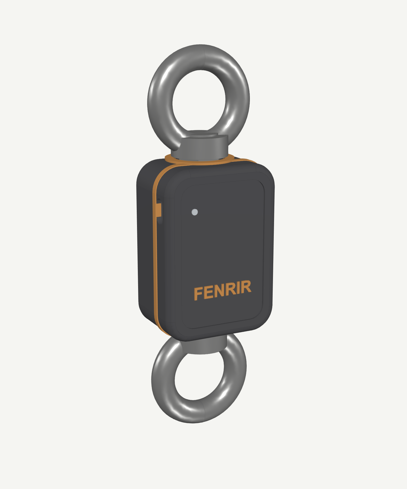

# Enclosure

Status: **concept geometry, revision A. Nothing printed, nothing fitted, nothing loaded.**
The model is built from datasheet and product-page dimensions. It is not released for printing until
the "measure first" list below has been checked on the received parts.

| View | File |
|---|---|
| Closed | [drawings/enclosure-concept-front.png](drawings/enclosure-concept-front.png) |
| Front cover removed (electronics bay) | [drawings/enclosure-concept-cover-off.png](drawings/enclosure-concept-cover-off.png) |
| Shell cut in half (steel cell inside) | [drawings/enclosure-concept-section.png](drawings/enclosure-concept-section.png) |

These are renders of the parametric model [`cad/fenrir_enclosure.py`](cad/fenrir_enclosure.py), not
photographs. Regenerate with `python mechanical/cad/fenrir_enclosure.py`; STEP and STL exports go to
`cad/out/`, which is git-ignored because they are not manufacturing data yet.

## Decisions (owner, 2026-11-16: 3D-printed, premium look, used from the prototype on)

| Topic | Decision |
|---|---|
| Architecture | One pod wraps the steel load cell. Both lifting eyes pass through the shell. The electronics sit in a bay on the front face of the cell |
| Load path | Unchanged and metal only: eye bolt → cell → eye bolt. The shell carries nothing |
| How the shell is held | It grips the cell's **upper block only**. Everywhere else there is a 1.5 mm gap, including around the lower eye bolt. A shell touching both halves of the cell would carry part of the force and falsify the reading |
| Same shell for prototype and PCB | The bay takes the two Adafruit boards and the battery now. The custom PCB is drawn to the same bay, so the shell does not change |
| Envelope | Shell 58.6 × 38.9 × 84.0 mm. Overall length over the eyes 194 mm (the eye bolts and the 76 mm cell set this; a 95 mm pod is not possible with a steel load path) |
| Look | Matte black shell, orange seam band and bolt collars, recessed front panel, one status light, USB-C on the side |
| Process | Ordered from a printing service. First choice: MJF nylon PA12, dyed black, for the shell; the orange parts printed separately. Resin (SLA) is not suitable: brittle |
| Markings | "FENRIR", the range, and "Not safety equipment". **No CE mark**: the device has not been assessed and must not carry one |

## Measure first (blocks the print order)

| What | Why | Value used in the model |
|---|---|---|
| Cell outline, slot positions, where the cable leaves | Grip pads must sit on the upper block only; the cable needs an exit | 50.8 × 19 × 76.2 mm from the datasheet; slots assumed |
| Thread depth in the cell | Sets how far the eye bolt enters and where the nut sits | not published |
| Eye bolt collar height and diameter of the bolts actually bought | The shell openings must clear nut and collar | DIN 580 nominal, collar height assumed 10 mm |
| Feather, ADC board and battery sizes, USB-C position | Bay fit and the side opening | product pages; battery 36 × 17 × 7.8 mm assumed |

## Not designed yet

- The split between front cover and back shell, the screws that close it, and the board mounts.
- The cable route from the cell to the ADC terminal. For first power-up the 3 m cable stays uncut
  and leaves through the seam; it is shortened only after the electrical checks pass, because
  cutting cannot be undone.
- The light pipe and any button (requirement F-16).
- Print tolerances and wall thickness checks for the chosen service.

## Checks this design will need (none done)

See V-23 and V-24 in the [verification matrix](../docs/verification/verification-matrix.md):
fit on the real parts, and proof that the shell does not change the reading (same calibration with
and without the shell).
